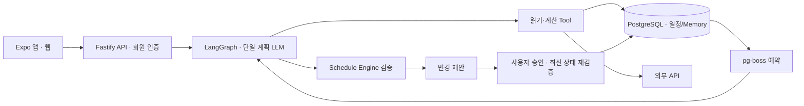

# PIKKU — 시계는 워치

**PIKKU는 사용자의 목표·일정·선호·현재 상황을 바탕으로 실행 가능한 다음 행동을 추천하고, 계획이 어긋나면 다시 조정하도록 돕는 AI 개인화 일정 비서입니다.** 타인과의 조율이 필요한 약속은 사용자 승인 아래 전화·이메일로 연락하는 흐름까지 연결합니다.

코디세이 AI 해커톤 2026 · 팀 **시계는 워치**

- **[웹앱 실행](https://pikku-bbikku-web-preview.vercel.app/)**
- **[제출 체크리스트 및 시연 안내](docs/SUBMISSION.md)**
- **[외부 자원 활용 내역](docs/EXTERNAL_RESOURCES.md)**
- 제출 기준은 `main`에서 선정해 `시계는 워치_소스코드.txt`에 기록한 **전체 커밋 해시**입니다. 이후 브랜치 변경과 심사 대상 커밋은 구분합니다.

## 해결하려는 문제

**계획을 세운 뒤에도 판단해야 할 일은 계속 남습니다.** 약속과 개인 작업을 병행하는 학생·직장인은 준비와 이동에 얼마나 걸리는지, 오늘 컨디션으로 무엇을 먼저 해야 하는지, 일이 늦어졌을 때 어떤 일정부터 조정해야 하는지 직접 판단합니다. 공동 약속을 바꾸려면 상대에게 설명하고 합의를 확인하는 일도 남습니다.

PIKKU는 이 판단과 조율의 부담을 줄이려 합니다. “어떻게 조정할까요?”라는 질문에 머무르기보다, 확인한 일정과 개인 맥락을 근거로 **“저녁 약속을 한 시간 앞당겨 준비 시간을 확보하는 건 어떨까요?”**처럼 구체적인 대안과 이유를 제시하는 것이 목표입니다. 정보가 부족하면 필요한 내용만 묻고, 변경과 연락은 사용자 승인 후 진행합니다.

### 개인 맥락에 따라 달라지는 추천

일정을 기록하고 정해진 시각에 알리는 기능에 더해, PIKKU는 **지금 이 사용자에게 실행 가능한 선택이 무엇인지** 판단하도록 설계했습니다.

- **같은 약속에도 다른 준비 계획:** 15시 약속에 이동 30분·도착 여유 10분이면 출발은 14시 20분입니다. 준비시간이 15분인 사람은 14시 5분, 45분인 사람은 13시 35분부터 준비해야 합니다. 개인 값은 Memory에서 조회하고 계산은 서버가 담당합니다.
- **같은 일정에도 다른 대안:** 사용자가 알린 피로, 내일의 중요한 일정, 선호 시간대에 따라 휴식이나 작업 시간 조정을 검토합니다. 입력하지 않은 컨디션이나 생활 패턴을 관측한 사실처럼 취급하지 않습니다.
- **지연돼도 필요한 부분만 조정:** 이후 일정에 영향이 없으면 유지하고, 충돌이나 미완료가 있으면 관련 작업의 대안을 검토합니다. 공동 약속은 상대와의 조율을 별도 단계로 다룹니다.

현재 개인화는 사용자가 명시한 선호·상황과 조회 가능한 일정에 기반합니다. 행동을 자동 학습하거나 건강 상태를 상시 파악하는 기능까지 완성한 것은 아닙니다. 판단 부담 감소와 경쟁 서비스 대비 우위는 아직 정량 측정하지 않았습니다. 기획 근거는 [PRD F03~F12](docs/PRD.md)와 [회의 맥락](docs/MEETING_ALIGNMENT.md)에 정리했습니다.

## 핵심 경험 — Plan → Act → Recover

| 흐름 | 사용자의 상황 | PIKKU가 돕는 방식 |
|---|---|---|
| **Plan · 계획** | “해야 할 일은 많은데 언제 하면 좋을까?” | 일정·선호·필요한 외부 정보를 조회해 가능한 시간과 이유를 제안하고, 사용자가 선택한 변경만 반영 |
| **Act · 실행** | “지금 무엇부터 준비하고 언제 출발하지?” | 준비·이동·여유시간 계산, 다음 행동 안내, 수행/참석 기록으로 실행 지원 |
| **Recover · 복구** | “늦었거나 못 끝냈는데 이제 어떻게 하지?” | 지연 영향과 작업의 필요성·기한을 확인해 영향받는 부분의 대안 제시. 영향이 없으면 기존 계획 유지 |

### 예시: 내일 중요한 발표가 있는데 오늘 저녁 약속도 있다면

사용자가 “내일 발표가 있는데 오늘 피곤하고 저녁 약속도 있어”라고 말하는 상황입니다.

1. **맥락 확인:** PIKKU가 발표·저녁 약속과 저장된 관련 선호를 조회합니다. 피로는 사용자가 전달한 일시 상황으로 다룹니다.
2. **대안 추천:** 가능한 시간과 고정 일정의 제약을 확인해 개인 준비 작업을 옮기거나, 저녁 약속 조율을 검토하도록 제안합니다. 이유와 선택지를 보고 사용자가 고릅니다.
3. **승인과 연락:** 공동 약속을 조정하기로 했다면 대상·채널·전달 내용·허용 대안을 확인한 뒤 전화 또는 이메일을 요청합니다. 추천 선택만으로 자동 발신하지 않습니다.
4. **결과 확인과 반영:** 상대 응답을 검토하고 승인 범위와 최신 일정을 다시 확인합니다. 승인 밖의 대안은 새 변경안으로 확인받으며, 합의가 확인되기 전에는 원래 약속을 유지합니다.

**연락대행은 추천을 실제 공동 일정 조율로 이어 주는 기능입니다.** 발신 성공과 상대의 수락, 일정 반영 완료는 각각 구분합니다. 위 사례는 제품 경험을 설명하는 시나리오이며, 이 대본 전체를 실서비스에서 검증했다는 뜻은 아닙니다. Gmail 실제 회신→가상 일정 반영 기록과 전화 발신·대화 기록, 후속 수정의 모의 검증은 [구현 기록](docs/IMPLEMENTATION_PLAN.md)에서 구분합니다. 최신 전화 흐름 전체의 실통화 재검증 완료를 주장하지 않습니다.

## AI 기술과 직접 개발한 부분

**LLM은 맥락을 해석하고 대안을 만들며, 서버는 시간·충돌·권한과 승인 범위를 검증합니다.** 시스템 프롬프트의 안내만으로 실행을 허용하지 않고 역할을 나눴습니다.

1. **조회:** 메인 LLM이 일정·Memory·외부 정보 중 필요한 Tool을 선택합니다.
2. **추천:** 조회한 근거로 구체적인 대안과 이유를 구성합니다. 빈 시간·시간 역산은 계산 Tool을 활용합니다.
3. **검증·승인:** Schedule Engine이 표현된 제약과 충돌을 검사하고, 사용자가 수락할 때 버전·만료·최신 상태를 다시 확인합니다.
4. **실행:** 검증을 통과한 범위만 저장합니다. 외부 연락은 별도 승인 경로를 거치며, 전화의 음성 대화는 ClawOps 관리형 음성 모델이 담당합니다.



- **모델:** `gpt-6.1-terra` / 추론 `high`, Responses API의 함수 호출을 사용합니다. 모델 학습이나 자체 기반 모델 개발은 하지 않았습니다.
- **직접 개발:** 사용자별 일정·Memory 구조, 도구 권한과 조회 범위, 빈 시간/시간 역산/충돌 검사, 버전·만료·멱등성에 결속된 제안 승인, 공동 연락과 결과 검토, 외부 캘린더 원본 연결, 앱 화면·상태·API 연결입니다.
- **실행 경계:** 모델이 직접 DB를 변경하거나 전화·메일을 발송하지 않습니다. 서버가 검증하고 사용자 승인 후 해당 실행 경로를 호출합니다.
- **설계 참고:** Hermes의 책임 분리를 참고했으며 Hermes를 설치하거나 포크하지 않았습니다. 실행 흐름은 LangGraph JS입니다.

| 영역 | 기술 |
|---|---|
| 앱·웹 | Expo 58, React Native 0.88, React 19, TypeScript, Pretendard |
| API·Agent | Node.js 22.13 이상, Fastify, LangGraph JS, Zod |
| 저장·예약 | PostgreSQL, pg-boss |
| 배포 | Vercel 웹, NAVER Cloud VM API·PostgreSQL, HTTPS 터널 |
| 외부 연동 | Google OAuth/Calendar/Gmail/People, Kakao, Open-Meteo, 서울 지하철, ClawOps |

정확한 패키지 버전은 `package-lock.json`, 자원·라이선스·보류 항목은 [외부 자원 표](docs/EXTERNAL_RESOURCES.md)를 확인하세요.

## 주요 기능과 현재 범위

| 기능 | 구현한 흐름 | 사용 조건·제한 |
|---|---|---|
| PIKKU 대화와 추천 | 조회·계산 Tool, 짧은 추천 선택지, 변경 제안, 수락·거절 및 대화로 수정 | 실제 모델 키 필요. 선택지 클릭 자체가 저장 승인은 아님 |
| 일정·할 일·루틴 | 홈·월간·일간 조회, 직접 입력, 수행/참석 기록, 한 단계 상태 취소, 반복 규칙과 회차 분리 | 루틴은 지정 범위 최대 31일 회차 생성. 기존 생성 회차는 규칙 수정으로 일괄 변경하지 않음 |
| 개인화 | 온보딩·선호/상황 카드와 사용자별 Memory | 모델은 필요한 키를 조회. 모든 선호를 항상 적용하거나 환각을 제거한다고 보장하지 않음 |
| Google 연결 | Google 회원 로그인, Calendar·Gmail·연락처별 OAuth 동의 | 회원 로그인과 서비스 권한은 별도. 테스트 OAuth 앱이면 허용된 테스트 계정 필요 |
| Calendar 가져오기 | 화면의 월 범위에서 기본 또는 사용자가 선택한 캘린더의 새 일정 자동 가져오기, 종일·투명·반복 회차 처리, 중복 방지 | 이미 가져온 원본의 수정·삭제는 자동 전파하지 않음. 원본 쓰기는 별도의 제한된 수동 동기화 |
| 경로·날씨 | 위치 공유/출발지와 이동수단 선택 후 장소·도보·대중교통·자동차 이동시간 조회 | 현재 교통 기준 추정. 미래 교통 예측 아님. Google/지도 등 각 계정·권한·키 필요 |
| 연락대행 | 승인 기반 Gmail 발송·회신 확인, ClawOps 전화 요청·승인·통화 결과 검토 | 서버에 등록된 사용자별 제공자 설정 필요. 통화 전사만으로 자동 일정 확정하지 않음 |
| 아침·저녁 검토 | 온보딩 기본 제안 09:00/21:00, 저장한 시간대로 서버 예약·브리핑/회고 | PostgreSQL·Scheduler·모델 필요. 설정 저장 전 자동 활성화하지 않음 |
| 기기 알림·건강 데이터 | 네이티브 알림 및 Apple HealthKit/Android Health Connect 어댑터 | 설치형 앱·기기 권한 필요. 실제 알림 울림·건강 데이터 양 플랫폼 검증은 보류. 웹 예약 알림은 미지원 |

**시간 트리거 범위:** 아침·저녁 예약과 매시간 자동 재계획은 다릅니다. 매시간 상태 확인·AI 자동 실행은 기획 후보이며 현재 완료 기능으로 소개하지 않습니다. 서버 예약 실행과 휴대폰에서 알림이 실제 울리는지도 별도로 검증합니다.

전화·메일·Calendar 연결은 사용자별입니다. 다른 사용자의 계정이나 자격을 자동 공유하지 않습니다. 미설정·권한 거부·결과 불명은 성공으로 표시하지 않으며, 자세한 구현/실사용 증거는 [구현 기록](docs/IMPLEMENTATION_PLAN.md)을 따릅니다.

## 웹앱 사용과 2분 시연

1. [웹앱](https://pikku-bbikku-web-preview.vercel.app/)에서 Google 로그인 후 선호를 입력하거나 건너뜁니다. Google 서비스 연결은 계정 설정에서 별도로 동의합니다. 일반 사용자는 개발 토큰을 입력하지 않습니다.
2. 할 일 하나와 고정 일정 하나, 관련 선호를 준비합니다. “오늘 피곤한데 고정 약속을 지키면서 이 작업을 언제 하면 좋을까?”처럼 개인 맥락을 포함해 추천을 요청합니다.
3. 추천 이유와 변경 시각을 확인합니다. **수락 전 원래 일정 유지 → 수락 → 홈/캘린더 반영**을 보여줍니다.
4. 지연 또는 미완료 상황을 입력해 유지/재추천과 그 이유를 확인합니다. 시간 안에 보여줄 대표 사례를 리허설로 정하고, 외부 연락은 준비된 계정·동의한 수신자가 있을 때만 별도로 시연합니다.

공개 OAuth가 테스트 계정 제한으로 거절되면 운영 담당자에게 등록을 요청하거나 아래 로컬 개발 경로를 사용합니다. 서버/API 키/외부 계정이 없는 상태에서 AI·외부 연동이 실행됐다고 표시하지 않습니다. 영상은 실제 앱의 입력→결과를 녹화해야 합니다.

## 로컬 실행

### 1. 설치와 환경설정

Node.js **22.13 이상**, npm, Git이 필요합니다. macOS에서 로컬 실행과 검사를 수행했으며 다른 OS 전체 조합을 검증하지는 않았습니다.

```sh
git clone https://github.com/codyssey-hackerton/codyssey-hackathon-bbikku.git
cd codyssey-hackathon-bbikku
# 제출물을 재현하려면 제공된 전체 커밋 해시로 git checkout <최종-커밋-해시>
npm ci
cp .env.example .env.local
```

`.env.local`의 `PIKKU_OPENAI_API_KEY`에 서버용 프로젝트 키를 입력합니다. 지정 모델 접근 권한이 있어야 하며 다른 모델로 자동 대체하지 않습니다. 키가 없어도 직접 일정 입력·조회는 가능하고 AI 요청은 미설정으로 응답합니다. 키·DB URL·OAuth 비밀값은 Git이나 `EXPO_PUBLIC_*`에 넣지 않습니다.

### 2. 가장 빠른 개발 실행

```sh
npm run dev:local
```

API(기본 `http://127.0.0.1:3001`)와 Expo Metro가 시작됩니다. Metro 터미널에서 `w`를 눌러 웹앱을 엽니다. 첫 화면 **개발 연결 설정**에서 API 주소와 로그에 표시된 `.local/dev-session-3001.txt`의 개발 토큰을 입력하고 적용합니다. 이는 Google 회원 로그인과 별개인 **로컬 개발 전용 경로**입니다. 토큰은 정상 종료 시 삭제되며, 포트가 다르면 파일명도 바뀝니다. 종료는 `Ctrl+C`입니다.

기본 메모리 모드는 서버 재시작 시 일정이 사라집니다. 보존 및 회원·루틴·동기화·예약 기능에는 PostgreSQL이 필요합니다.

### 3. PostgreSQL과 시간 예약

```sh
# 터미널 1 — 로컬 DB 시작 및 유지
npm run dev:db
# 터미널 2 — DB·예약을 사용하는 API와 Expo
npm run dev:local -- --postgres --scheduler
```

로컬 DB는 `.local/`에 유지되며 Docker는 필수가 아닙니다. 외부 PostgreSQL을 쓸 때는 `PIKKU_DATABASE_URL`을 설정하고 `--postgres`를 생략합니다. `--postgres`와 명시 DB URL을 동시에 쓰지 않습니다. 앱에서 아침/저녁 설정을 저장해야 해당 사용자의 예약이 활성화됩니다. 서버 예약과 기기 알림 전달은 별도 기능입니다. [DB 상세](docs/LOCAL_POSTGRES.md)

### 4. 선택 연동 설정

| 기능 | 서버 설정·준비 |
|---|---|
| Google 회원 로그인 | PostgreSQL, `PIKKU_GOOGLE_OAUTH_CLIENT_ID`, `PIKKU_GOOGLE_OAUTH_CLIENT_SECRET`, `PIKKU_GOOGLE_OAUTH_REDIRECT_URI` |
| Calendar·Gmail·Google 연락처 | 위 설정 + `PIKKU_GOOGLE_USER_CREDENTIAL_DIR` 절대경로, 해당 Google API 활성화, 사용자별 OAuth 동의 |
| 지도·이동시간 | `PIKKU_KAKAO_REST_API_KEY`, 제공자 API별 사용 권한 |
| 날씨 | Open-Meteo 사용, 별도 API 키 없음 |
| 지하철 | `SEOUL_SUBWAY_API_KEY`; 기본 HTTPS, 임의 HTTP 우회 없음 |
| 전화 | `PIKKU_PHONE_CREDENTIAL_DIR`의 사용자별 서버 자격 설정. 앱에 제공자 비밀값을 넣지 않음 |
| 웹 API 접근 | API의 `PIKKU_WEB_ORIGINS`에 정확한 웹 Origin, 웹 빌드의 `EXPO_PUBLIC_API_URL`에 접근 가능한 API 주소 |

OAuth 콜백은 공개 **HTTPS** 주소의 `/v1/google/oauth/callback`이며 Google Cloud 등록값과 정확히 일치해야 합니다. 로컬 회원 로그인 테스트도 API에 도달하는 HTTPS 콜백과 테스트 사용자 설정이 필요합니다. Calendar/Gmail/People 동의와 전화 제공자 설정은 [제공자 안내](docs/PROVIDER_SETUP.md), [회원·루틴·동기화 안내](docs/MEMBER_ROUTINE_CALENDAR.md)를 참고하세요. 기존 단일 개발 계정 이관 설정은 새 회원의 권한을 대체하지 않습니다.

### 5. 앱 빌드와 검사

```sh
npm run typecheck
npm test
npm run export:web --workspace @pikku/mobile
npm run export:mobile
npm run dev:local -- --smoke
```

`npm test`는 테스트 DB 미설정 시 일부 PostgreSQL 검사를 건너뜁니다. 별도 테스트 전용 로컬 DB를 시작한 뒤 `npm run test:postgres`로 확인하며 운영 DB를 사용하지 않습니다. 실제 모델 검사는 키가 있을 때만 `npm run verify:model -- --live`로 수행합니다(합성 입력, 최대 두 번 모델 요청). [모델 검사 안내](docs/MODEL_VERIFICATION.md)

JS export는 설치용 바이너리가 아닙니다. HealthKit·Health Connect 등 네이티브 모듈을 사용하는 앱은 Expo Go만으로 검증할 수 없고 development build, 플랫폼 도구 및 서명이 필요합니다. 설치·알림·건강 권한의 실기기 검증은 별도입니다. [모바일 안내](apps/mobile/README.md)

## 확인한 검증과 한계

- `main` 통합 때 전체 workspace 타입 검사, 모바일 548건, 도메인 44건, API 승인·저장·Calendar 집중 56건이 통과했습니다. DB 미설정 5건은 skip이며, 별도 임시 PostgreSQL의 회원 분리·저장/복구 2건은 통과했습니다.
- 이후 추천 우선 프롬프트 변경은 문서 동일성·추천 선택지·승인 전 불변을 포함한 5건과 API 타입 검사를 통과했습니다. 최신 프롬프트의 실제 모델 응답 품질을 별도로 측정한 것은 아닙니다.
- `2fbc0c8` 프롬프트 배포 때 공개 웹 HTML/JS와 API health 응답, 두 API의 프롬프트 소스 일치를 확인했습니다. 이것을 신규 사용자의 Google 동의·전체 E2E 성공으로 확대하지 않습니다.
- 실제 모델/외부 API 일부 실연결 기록과 모의 검증을 구분해 [구현 기록](docs/IMPLEMENTATION_PLAN.md)에 보존했습니다. 실기기 알림 울림, 워치 건강 데이터, 모든 계정·외부 제공자 조합은 검증하지 않았습니다.

## 팀 소개 | 다섯 개의 전문성을, 하나의 AI 비서로

PIKKU는 서비스 기획과 사용자 경험 설계부터 모바일 앱·서버, 데이터·Memory, AI Agent, 외부 API 및 음성 연동까지 다섯 가지 전문 영역을 결합한 프로젝트입니다. 각 팀원은 공통 데이터·API 계약을 기준으로 협업하며, 개인화 추천부터 사용자 승인과 실행까지 하나의 서비스로 연결합니다.

| 팀원 | 전문 영역 | 핵심 담당 및 기여 |
|---|---|---|
| 홍빈 · 팀장 | Product · UX | 서비스 기획 및 PRD, UX/UI와 서비스 전체 경험 설계, 추천·승인 사용자 흐름, 통합 QA·시연·발표 총괄 |
| 세진 | App · Server | 모바일 앱·백엔드 아키텍처, Fastify·LangGraph 기반 Agent 실행 구조, 공통 API 계약, 승인 흐름 및 서비스 통합 |
| 찬욱 | Data · Memory | PostgreSQL 데이터 모델, 일정·승인 상태의 영속 저장, 사용자 Memory, pg-boss Scheduler 및 VM 인프라 |
| 영휘 | AI Agent · Prompt | Agent 행동 정책, 질문·추천 로직, 시스템 프롬프트, Tool 사용 가드레일, 예외 처리 및 품질 평가 |
| 서현 | External · Voice | Google Calendar·Gmail 연동, OAuth 및 이동정보 API, ClawOps 기반 전화·음성 연동·검증 |

### 협업 방식

**제품·UX 정의 → 공통 데이터·API 계약 수립 → 전문 영역별 병렬 개발 → 서비스 통합 → 사용자 승인 기반 E2E 검증**

홍빈이 정리한 제품 요구사항과 사용자 흐름을 기준으로 담당 영역을 연결하고, 세진을 중심으로 앱·서버를 통합하며 팀이 함께 검증합니다. AI가 추천한 변경은 서버 검증을 거쳐 사용자의 명시적 승인 이후 반영하도록 설계했습니다.

상세 인계 범위는 [팀 계획](docs/TEAM_PLAN.md)을 참고합니다. 개인별 실제 기여와 연동 검증 범위는 최종 제출 기준으로 확인하며, 위 역할 소개가 모든 기능의 실연결 검증 완료를 의미하지는 않습니다.

### 프로젝트 상세 문서

- [PRD](docs/PRD.md) · [아키텍처](docs/ARCHITECTURE.md) · [ADR](docs/ADR.md) · [공통 계약](docs/CONTRACTS.md)
- [시스템 프롬프트](docs/AGENT_PROMPT.md) · [디자인 연결](docs/DESIGN_INTEGRATION.md) · [건강 데이터](docs/WEARABLE_INTEGRATION.md)
- [구현·검증 기록](docs/IMPLEMENTATION_PLAN.md) · [제출 체크리스트](docs/SUBMISSION.md) · [외부 자원·출처](docs/EXTERNAL_RESOURCES.md)

## 출처와 공개 범위

Pretendard(SIL OFL 1.1), Streamline Core(CC BY 4.0), Lucide/Feather(ISC/MIT) 등의 출처와 라이선스를 [외부 자원 표](docs/EXTERNAL_RESOURCES.md)에 정리했습니다. 공개 저장소라고 해서 모든 코드·디자인에 일괄적인 재사용 라이선스를 부여한 것은 아닙니다. 사전 보유 코드·디자인 권리·팀의 추가 사용 자원은 제출 전 팀 확인이 필요합니다.
