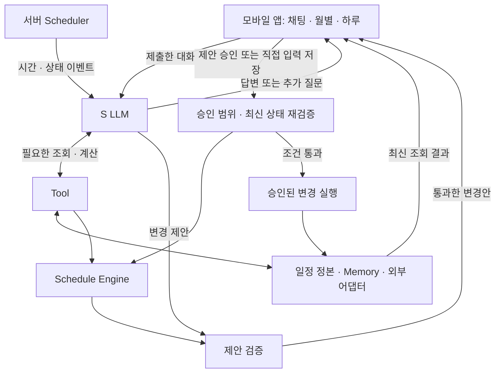

# PIKKU 아키텍처 v1

작성: 2026-10-31 · 세진님/00 MAIN. **구현 완료 문서가 아니다.** 제품 범위는 [PRD](PRD.md), 결정 상태는 [ADR](ADR.md), 입출력은 [CONTRACTS](CONTRACTS.md), 실제 팀 역할은 [TEAM_PLAN](TEAM_PLAN.md)을 따른다.

## 1. v1 개발 기준과 미정 사항

| 구분 | 결정 / 상태 |
|---|---|
| 모바일 | Expo + React Native + TypeScript. 채팅·월별·하루 화면. iOS/Android 목표, 실기기 검증은 별도. 디자인은 팀 시안 반영. |
| 서버·Agent | Node.js + TypeScript + Fastify, 하나의 백엔드 안에서 LangGraph JS로 단일 S LLM 실행. Hermes 구조는 참고하되 설치·포크하지 않음. |
| 모델 | 사용자 지정 `gpt-6.1-terra`, `reasoning.effort: high`, Responses API. 실제 호출·합성 사례 검증 기록 있음. 대표 성능·모델 비교 미검증. |
| 저장·시간 트리거 | PostgreSQL, pg-boss 서버 Scheduler. 로컬 검증 완료, 별도 공개 테스트는 VM PostgreSQL 사용 인계. 저녁/아침 사용자별 설정, 주기 확인 자체는 LLM 호출이 아님. |
| 승인 | 직접 폼 저장은 그 입력만 확인. AI 추가 변경은 별도 승인. 공동 약속 시간 조정은 연락 승인·상대 수락·최신 재검증 후 반영. |
| 시연 목표 | [PRD §2](PRD.md)의 기본 추천 E2E + 실제 연락대행 + 전날/아침 검토. 단계별 개발이며 완료 증거를 별도 기록. |
| 제공자 | Gmail 우선 연결 선택. Google Calendar, Twilio+음성, Kakao/TMAP은 후보. 실제 접근·호출·국가/계정 제약은 병렬 검증 후 확정. |
| 음성 | Twilio Gather/Say + 기존 Terra/high의 승인 옵션 분류·별도 DTMF 확인. 영속 세션·서명·회신/일정 검증은 서버 코드. 자유 대화형 음성은 후속. |
| 미정 | 정식 앱 인증, 고정 API 도메인, 푸시, 최종 시연 기기, 다중 캘린더 쓰기 정책. 전화 실통화는 발신번호·공개 웹훅 준비 후 검증. |

이는 2026-10-31 세진님의 문서 확정·개발 착수 요청에 따른 구현 기준이다. 팀 전체 검토 완료나 실제 실행 성공을 뜻하지 않는다. 코드 골격은 재사용하되 [CONTRACTS v1](CONTRACTS.md)에 맞추고, 제공자 검증을 기다리지 않고 공통 경계부터 구현한다.

## 2. 구성요소의 책임과 근거

| 구성요소 | 담당하는 일 | 이유·PRD 근거 | 짧은 예시 |
|---|---|---|---|
| Agent / S LLM | 의도·상황 해석, 필요한 질문, Tool 선택, 개인화된 제안과 설명 | 맥락에 따라 답이 달라지는 F03·F04·F06·F08 | “오늘 피곤해”라는 입력을 반영해 공부 시간을 조정할지 판단한다. |
| Tool | 일정·Memory 조회, 계산 호출, 외부 정보 어댑터 등 명시된 입출력 제공 | 실제 데이터와 근거가 필요한 F04·F05·F12 | 일정 조회 결과에 없는 약속을 만들어내지 않는다. |
| Schedule Engine | 시간 역산, 겹침·마감·빈 시간·고정/완료 일정 보호를 코드로 검사 | 같은 입력에는 재현 가능한 검증이 필요한 F05·F06·F10·F11 | 15시 약속, 이동 30분, 여유 10분이면 출발 14:20을 계산한다. |
| 승인 및 실행 | 사용자가 확인한 변경 범위 기록, 최신 상태 재검증, 승인된 변경만 저장 | 선택권과 오래된 제안 방지가 필요한 F07 | 공부 이동만 승인했다면 다른 약속이나 외부 연락을 실행하지 않는다. |
| Memory | 명시 선호·일시적 상황·관측·추정의 출처와 유효기간 구분, 관련 정보 조회 | 근거 있는 개인화가 필요한 F03 | “오늘 피곤함”을 영구적인 오전 활동 기피로 저장하지 않는다. |
| Scheduler | 서버에서 시간/상태 이벤트 생성, 실행 대상 확인, 중복 제거 후 Agent 호출 | 요청 외 시작 조건인 F06·F09·F10, 최신 아침 재점검 요구 | 아침에 재점검하되 변화가 없으면 계획을 유지한다. |

**시스템 프롬프트와 Schedule Engine은 다르다.** 프롬프트는 S LLM에게 “부족할 때 질문하고 충돌을 확인하라”는 행동을 안내한다. Engine은 실제 시간 계산·제약 검증을 수행한다. S LLM은 Tool을 통해 계산을 요청할 수 있지만, 변경 반영 직전의 검증은 서버가 반드시 실행한다. LLM이 검증 Tool을 호출하지 않았다고 검증을 생략하지 않는다.

고정 일정 보호는 AI의 임의 변경을 막는 원칙이다. 사용자가 해당 고정 일정 자체를 명시적으로 수정하면 그 범위와 권한을 검증한다. 외부 공동 일정은 제공자 수정 권한도 별도 확인한다. 고정 공동 약속을 옮기는 추천은 사용자가 조정 대상을 명시적으로 선택한 범위에서 검토용 대안을 만들며, 실제 적용은 연락 승인·상대 수락 뒤에만 허용한다. 상세 입력은 CONTRACTS의 coordinationTarget을 따른다.

## 3. 실행 흐름

1. **대화:** 제출된 채팅 입력은 같은 S LLM이 처리한다. 타이핑 중인 글자나 화면 이동마다 호출하지 않는다. “고마워”에는 답변만 하고 일정 조회·Engine·재계획을 의무 실행하지 않는다. 별도 의도 분류 LLM도 기본 구조에 두지 않는다.
2. **추천:** 필요한 정보만 조회·질문하고, S LLM이 변경 대상·이유·대안을 구조화한다. Engine 검증 실패는 충돌 설명·정보 보완으로 돌려보낸다. 제안 저장은 확정 일정 저장과 구분한다.
3. **승인:** 앱이 정확한 변경 전후와 제안 버전을 보여준다. 선택한 안만 승인하며, 안을 수정하면 새 내용에 대한 확인이 필요하다.
4. **반영:** 서버가 승인 주체·대상·최신 일정/맥락·시간 유효성을 다시 확인한다. 기준 일정/맥락이 바뀌면 기존 승인을 사용하지 않고, 재검증한 안의 내용이 같아도 새 버전으로 재확인받는다. 검증과 저장 사이의 동시 변경도 버전 조건으로 막고 결과를 저장한다. 완료된 결과를 세 화면이 함께 조회한다.
5. **직접 입력:** 일정 폼의 저장은 그 폼에 표시된 변경의 확인이다. 서버 검증을 거쳐 해당 입력만 반영하며 추가 AI 변경은 제안으로 남긴다. 충돌이 있으면 알리고 해결 선택을 받는다. v1은 충돌 저장을 거절하고 해결 선택을 받는다.

사용자가 “오늘 4시 반에 약속 생겼어”라고 **채팅만 보낸 것**과 폼의 저장 버튼을 누른 것은 구분한다. 채팅에서는 해석한 시간·대상과 필요한 확인을 보여주고 F07에 맞게 확정한다. 직접 저장·완료 체크인 같은 명시적 앱 조작은 LLM 성공을 기다리지 않고 해당 조작의 검증 경로를 사용할 수 있으며, 이후 영향 검토가 필요하면 같은 Agent에 상태 이벤트를 전달한다.

**공동 약속의 연락대행 흐름:** 변경안 검증 → 사용자에게 상대·채널·전달 내용·허용 대안 확인 → 실제 전화/이메일 → 상대 응답 확인 → 최신 일정·권한 재검증 → 합의된 변경 반영. 상대 수락 전에는 기존 약속을 유지하고 변경 요청을 별도 표시한다. 발송·통화 연결과 일정 합의 완료는 구분한다. 상대가 승인 범위 밖의 시간을 제시하거나 일정이 다시 바뀌면 사용자에게 새 안을 확인받는다. 개인 일정의 직접 저장과 공동 약속의 조정은 서로 다른 경로다.

## 4. Scheduler와 시간 트리거

추천의 판단은 S LLM, 실행 시각 관리는 서버 Scheduler가 맡는다. 앱을 닫은 상태의 일정 실행을 앱 내부 타이머에 의존하는 구조로 만들지 않는다. 채택한 서버·스케줄러의 지속 실행과 실패 복구는 실제 환경에서 검증해야 한다.

| 시작 조건 | 처리 방향 | 범위 상태 |
|---|---|---|
| 사용자 대화 제출 | 같은 S LLM이 답변/질문/Tool 사용을 판단 | v1 기본 대화·조회·제안 |
| 일정 저장·지연·수행 상태 변경 | 확정된 상태를 기준으로 영향 범위 검토, 영향 없으면 유지 | v1 단일 사례부터 연결 |
| 전날 추천 시각 | 다음 날 일정·선호·현재 상황으로 제안 | v1 서버 트리거 목표; 21시는 예시 |
| 아침 재점검 시각 | 현재 일정·사용자가 제공한 상황을 다시 확인, 바뀔 이유가 있으면 대안 제안 | v1 서버 트리거 목표; 시각은 사용자 설정 |
| 주기적 상태 확인 | 실행할 작업이 있는지 코드로 확인 | 매 확인마다 LLM 호출·푸시를 뜻하지 않음 |

시간대와 대상 날짜, 실행 이유, 중복 방지 키를 이벤트에 담는다. 같은 예약 이벤트 재전달은 새 추천을 중복 생성하지 않도록 처리한다. 신규 사용자 입력은 별도 이벤트이며, 이미 예정된 검토와 합칠지는 내용·버전을 확인해 결정한다. v1은 60분 초과 밀린 예약을 skipped로 기록한다. 상세 이벤트·설정은 CONTRACTS §5를 따른다.

시간 트리거는 일정 변경·전화·이메일 발송의 승인이 아니다. 앱 결과 저장과 실제 푸시 전달도 별개다. 무응답은 늦잠·미완료·승인으로 해석하지 않는다.

### Scheduler 선택 근거와 대안

DB 제품과 예약 실행기를 분리해서 선택할 수 있다. Supabase를 사용하지 않아도 일반 PostgreSQL을 사용하면 일정·승인·Memory 계약을 유지할 수 있다. 다음 장단점은 공식 기능을 바탕으로 한 본 프로젝트의 설계 판단이며 설치·PoC 결과가 아니다.

| 방식 | 장점 | 부담·조건 |
|---|---|---|
| Hermes 내장 Cron | 일회성/반복 작업과 실행 기록·결과 전달 기능을 재사용. 기본 Gateway가 주기적으로 실행한다. | Hermes 실행 환경 운영이 필요하다. 새 Agent 세션에 앱 사용자의 일정·Memory를 정확히 조회하고 앱의 승인 경로로 연결하는 작업은 별도다. |
| LangGraph JS + `pg-boss` + PostgreSQL | Node.js 백엔드에서 예약·작업 큐를 DB에 저장하고 같은 Agent 흐름을 호출. 별도 Redis 없이 구성 가능. | 스케줄러/작업 실행 프로세스와 DB가 실행 중이어야 한다. 시간대·밀린 작업·실행 제한·외부 효과의 중복 방지는 앱 정책과 함께 검증한다. |
| LangSmith Deployment의 Cron | 배포된 Agent를 예약 실행하는 API를 재사용하고 직접 작성할 예약 로직을 줄인다. | LangGraph 라이브러리 단독 기능과 구분한다. 별도 배포 방식·비용·접근 조건을 검토하며 문서상 Cron 시각은 UTC다. |

**채택:** `pg-boss → LangGraph → 제안·검증·승인`. 일반 PostgreSQL에서 실행하고 호스팅은 별도로 정한다. 백엔드 작업 실행기는 Codex 개발 Worker 01~06과 다른 구성요소다. 타이머만을 위해 Hermes와 LangGraph 두 런타임을 함께 운영할 필요는 없다. LangGraph 승인 대기 체크포인트와 제품의 승인/연락 상태는 구분하며, v1 제품 상태는 DB 정본을 사용한다.

근거: [Hermes Cron](https://hermes-agent.nousresearch.com/docs/user-guide/features/cron), [Gateway 실행 구조](https://hermes-agent.nousresearch.com/docs/developer-guide/cron-internals), [pg-boss](https://github.com/timgit/pg-boss), [LangSmith Cron](https://docs.langchain.com/langsmith/cron-jobs). 어떤 방식도 작업 큐의 재시도를 외부 전화·메일의 정확히 한 번 실행 보장으로 간주하지 않는다.

## 5. Memory·일정·다중 캘린더

- **일정 정본:** 확정 일정과 작업 상태. 채팅·월별·하루 화면은 같은 식별자와 버전의 데이터를 사용한다.
- **제안/승인 기록:** 아직 반영되지 않은 변경안과 승인한 버전. 확정 일정과 구별한다.
- **Memory:** 명시 선호, 일시 상황, 실제 관측, 추정. 관련 정보만 제공하고 출처·유효성을 유지한다. 채팅 기록이나 Agent 체크포인트 전체가 곧 장기 Memory는 아니다.
- **캘린더 출처:** 앱 내부 일정 ID에 여러 외부 출처를 연결한다. 제공자·계정·캘린더·원본 이벤트·반복 회차의 식별을 보존한다. 외부 동일성 확인과 요청 재시도의 중복 실행 방지는 서로 다른 문제다.

Google과 다른 캘린더에 복제된 회의는 확인 가능한 공통 식별 근거 또는 사용자 확인이 있으면 한 건으로 표시한다. 제목·시간만 같으면 중복 후보로 남긴다. 매주 회의의 다른 회차는 합치지 않는다. 원본 시간이 서로 다르면 임의의 값을 선택하거나 서로 덮어쓰지 않고 충돌을 표시한다. 어느 출처에 쓸지, 양방향 동기화 범위는 서연님·찬욱님과 별도 결정한다.

## 6. 병렬 개발과 확인할 증거

1. 최소 계약으로 모바일·도메인·API를 연결하고, 저장/모델 어댑터는 교체 가능한 경계로 구현한다.
2. PostgreSQL 호스팅과 외부 제공자 검증을 동시에 진행한다. 미설정 경로는 not_configured, memory 테스트 저장은 durable=false로 보고한다.
3. 기본 E2E → 실제 연락대행 → 시간 트리거·지연/미완료 사례를 통합 검증한다. 기본 추천만 완료한 상태를 전체 MVP 완료라고 하지 않는다.
4. 시연 기기, 전화/메일 채널별 성공·실패, 푸시 여부를 PM과 확정한다. 전화 검증 실패를 이메일/모의 통화 성공으로 대체하지 않는다.

서버 재시작 복구는 저장·작업 안정성 검증이다. 별도 사용자 기능으로 늘리지 않으며 실제 PostgreSQL 환경에서 확인한다. 세진님은 구조·통합, 찬욱님은 저장·VM, 영휘님은 프롬프트·평가, 서연님은 외부 제공자, PM은 화면·시연·QA를 맡는다. [팀 인계](TEAM_PLAN.md).

## 7. 외부 API — 고정 경계와 병렬 검증

최신 사용자 요구로 실제 전화·이메일 연락대행은 핵심 흐름이다. 외부 API 전부를 나중으로 미루지 않고 **시연 행동·첫 제공자 후보·입출력·승인 범위를 지금 정리하고 구현과 병렬로 실제 연결 검증 후 제공자를 채택**한다. 아래는 추천 후보이며 계정 접근·호출 성공을 확인한 목록이 아니다.

| 영역 | 첫 후보와 역할 | 지금 필요한 검증 |
|---|---|---|
| 캘린더 | Google Calendar OAuth 계정 연동. 선택한 원본 조회와 권한 있는 일정 수정. 기기 캘린더 접근과 구분. | 테스트 계정의 읽기/쓰기 동의, 실제 캘린더 선택, 원본 ID·반복 회차, 상대 수락 이후 쓰기 및 충돌. [권한](https://developers.google.com/workspace/calendar/api/auth) |
| 이메일 | Gmail API로 사용자 계정에서 실제 변경 요청 발송. 회신 자동 확인은 읽기 권한과 별도 처리. | `gmail.send`와 `gmail.readonly`의 접근 범위·심사 조건, 테스트 계정, 실제 송수신·스레드 연결. Calendar 동의만으로 Gmail 접근 불가. [권한](https://developers.google.com/workspace/gmail/api/auth/scopes) |
| 전화 | Twilio Programmable Voice + 양방향 음성 연결을 1차 PoC 후보로 검토. 실제 발신·대화와 통화 결과를 앱에 연결. | 발신번호 확보, 계정·한국 대상 통화 조건, 양방향 한국어 음성·지연·응답 확인. 사용자의 휴대폰 번호로 자동 발신된다고 가정하지 않는다. [발신](https://www.twilio.com/docs/voice/tutorials/how-to-make-outbound-phone-calls), [양방향 음성](https://www.twilio.com/docs/voice/media-streams) |
| 지도·이동시간 | 국내 이용 가정 시 장소/좌표는 Kakao Local, 이동시간은 TMAP을 우선 비교 후보로 검토. 제공자 수를 줄일 수 있는지는 실제 지원 확인 후 결정. | 지도 표시·장소 검색·자동차/도보/대중교통 시간 구분, 시연 이동수단·구간의 지원·정확도·호출 제한. [Kakao Local](https://developers.kakao.com/docs/ko/local/dev-guide), [TMAP](https://openapi.sk.com/products/preview/tmap?menuSeq=4&svcSeq=4), [대중교통](https://openapi.sk.com/products/detail?menuSeq=492&svcSeq=59) |

Terra는 음성 입출력을 직접 지원하지 않으므로 일정 판단용 `gpt-6.1-terra/high`를 유지하면서 전화에는 STT/TTS 또는 별도의 실시간 음성 모델 계층이 필요하다. 전화 중에도 승인된 대안 범위를 넘는 약속 확정 권한을 주지 않는다. 음성 계층의 제공자·모델은 아직 미정이다. [Terra 지원 범위](https://developers.openai.com/api/docs/models/gpt-6.1-terra)

전화 PoC의 구체 조건: Twilio의 한국 안내는 일반 번호 대상 발신을 지원한다고 설명하지만 실제 계정의 번호·국가 권한·표시와 통화 성공은 확인 전이다. 현재 체험 문서에서는 `<Stream>`과 `<ConversationRelay>`를 제한하므로 이 방식의 양방향 AI 통화를 무료 체험만으로 검증할 수 있다고 가정하지 않는다. 계정 업그레이드 필요 여부와 비용을 확인한 뒤 제공자를 채택한다. [한국 지원](https://static1.twilio.com/en-us/guidelines/kr/south-korea-voice-guidelines---twilio), [체험 제한](https://www.twilio.com/docs/usage/trials/try-out-voice)

구현 순서는 Gmail 실제 발송 경로를 먼저 연결하면서 전화의 발신·양방향 음성 가능성을 병렬 검증하는 것이다. 전화 요구를 이메일이나 링크로 축소한 결정은 아니다. 문서는 이 선택과 검증 결과를 기록하는 수단이며, 제공자 미확정이 공통 계약 기반 개발을 막지 않는다. 실제 사람에게 발신·발송하는 PoC는 테스트 상대·내용·실행 승인을 별도로 확인한 뒤 수행한다.

2026-10-31 프로젝트 준비 상태 점검: 프로젝트 안에서 실제 자격증명 설정이나 완성된 제공자 연동을 확인하지 못했다. Calendar/Gmail·Twilio·Kakao/TMAP은 candidate/not_configured, Terra/high는 selected/not_configured이며 인증된 외부 호출은 수행하지 않았다. 팀은 프로젝트용 API 접근 수단, Google OAuth 테스트 계정/범위, 전화 계정·발신번호/음성 제공자, 시연 이동수단을 준비한다. 키는 저장소·채팅·보고서에 넣지 않고 프로젝트 비밀 설정으로 전달한다. 이는 당시 로컬 조사이며 별도 배포 환경의 상태를 단정하지 않는다.

후속 상태(2026-10-31): 실제 Terra/high 추천·예약·승인을 합성 일정으로 검증했다. 사용자는 로컬 Gmail 발송 작업·확인을 완료했다고 보고했다. Calendar 읽기·선택 가져오기에 이어 Gmail 회신 읽기·사용자 확인, 제한된 Twilio 음성 선택 대화·명시적 번호 확인·조건부 내부 일정 반영을 코드·UI·합성 제공자/실제 PostgreSQL로 연결했다. Twilio 키의 실제 읽기 인증은 성공했으나 앱이 요구하는 소유 발신번호가 없으며 실통화는 하지 않았다. Gmail 회신 읽기 동의·profile HTTP200은 로컬에서 확인했으며, 실제 회신 조회와 Calendar 동의/조회·새 코드 배포는 별도다. 최신 검증은 [구현 계획](IMPLEMENTATION_PLAN.md)과 [제공자 설정](PROVIDER_SETUP.md)을 따른다.
